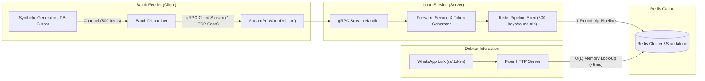

# Keceku Suplesi Engine (Monorepo Piloting)

Implementasi performa tinggi untuk subsistem **Pre-Warming Data Debitur** ke **Redis Cluster** menggunakan **gRPC Client Streaming** dan **Redis Pipeline** sebelum WhatsApp Blast diluncurkan pada aplikasi Keceku (Suplesi Otomatis Kupedes BRI).

Struktur repositori ini mengadopsi standar arsitektur monorepo Go Clean Architecture yang konsisten dengan [website-toko-sayur/user-service](https://github.com/website-toko-sayur/user-service), mencakup **Server (gRPC + Redis)** dan **Batch Feeder (Client Streaming)** dalam satu monorepo piloting.

---

## 🏗️ Struktur Folder (Monorepo Clean Architecture)

```
├── bruno/                                # Koleksi API Bruno 4.2.1 (REST & gRPC)
│   ├── REST-API/                         # Koleksi request HTTP REST (.bru)
│   ├── gRPC/                             # Request gRPC Stream (.bru)
│   ├── environments/local.bru            # Environment local (baseUrl & grpcUrl)
│   └── bruno.json                        # Metadata koleksi Bruno
├── cmd/                                  # Cobra CLI Commands & Entrypoints
│   ├── root.go                           # Root command & inisialisasi Viper .env
│   ├── start.go                          # Command start server (alias: server)
│   ├── feeder.go                         # Command client streaming batch feeder
│   └── pilot.go                          # Command automated integrated pilot test
├── config/                               # Konfigurasi aplikasi
│   ├── config.go                         # Viper config loader (App, Redis, Feeder)
│   ├── fiber.go                          # Inisialisasi Fiber v3 & Error Handler
│   ├── redis.go                          # Universal Redis client (Standalone/Cluster)
│   └── zerolog.go                        # Zerolog logger dengan format konsol dev & JSON prod
├── gen/                                  # Generated Protobuf Go code
│   └── loan/v1/
│       ├── loan_prewarm.pb.go
│       └── loan_prewarm_grpc.pb.go
├── internal/
│   ├── adapter/                          # Adapter Layer
│   │   ├── handler/
│   │   │   ├── grpc/                     # gRPC Handler
│   │   │   │   └── prewarm_grpc_handler.go  # StreamPreWarmDebitur Handler
│   │   │   ├── http/                     # Fiber HTTP Handlers
│   │   │   │   ├── health_check_handler.go  # /health & /api/check
│   │   │   │   └── offer_handler.go         # /s/:token (Simulasi klik WA debitur)
│   │   │   └── response/
│   │   │       └── default_response.go   # Standard JSON response format
│   │   └── repository/
│   │       └── prewarm_redis_repository.go  # Redis Pipeline batching & cache lookup
│   ├── app/                              # App Lifecycle & Dependency Injection
│   │   ├── app.go                        # Server lifecycle & graceful shutdown
│   │   └── feeder_app.go                 # Feeder client runner & profiling stats
│   └── core/                             # Core Domain Layer
│       ├── domain/
│       │   ├── entity/                   # Domain Entities
│       │   │   └── debitur_entity.go     # Debitur & Suplesi Offer Entity
│       │   └── model/                    # Domain Models & DTO
│       │       └── prewarm_model.go      # Feeder job config & health model
│       └── service/                      # Business Logic Layer
│           ├── feeder_service.go         # Streaming generator & dispatcher
│           └── prewarm_service.go        # Chunk processing, token gen, & Redis batching
├── proto/                                # Protocol Buffer Definitions
│   └── keceku/loan/v1/
│       └── loan_prewarm.proto            # Definisi kontrak gRPC Client Streaming
├── utils/                                # Helpers & Utilities
│   ├── constant.go                       # Redis key prefixes & default TTL
│   └── token.go                          # Cryptographically secure URL token generator
├── .env.example                          # Contoh variabel environment
├── go.mod
├── Makefile                              # Otomasi build, proto, server, feeder, dan pilot
└── main.go                               # Main entry point (cmd.Execute())
```

---

## ⚡ Arsitektur Solusi & Keunggulan



1. **Memory Footprint Tetap Konstan (~20 MB):** Menggunakan *channel streaming* dan *batch cursor* per 500 baris, bukan memuat 100.000 debitur sekaligus ke RAM.
2. **Network Round-Trip Minimal:** Mengalirkan 100.000 data hanya dalam 200 pesan chunk di 1 koneksi stream HTTP/2 tunggal, dan dieksekusi ke Redis menggunakan **Redis Pipelining**.
3. **Mendukung Redis Cluster Otomatis:** Menggunakan `redis.UniversalClient` yang menangani sharding cross-slot secara transparan tanpa galat `CROSSSLOT`.

---

## 🚀 Panduan Menjalankan

### 1. Prasyarat
- Go 1.26+
- Docker & Redis (atau Redis lokal di port `6380` dengan password `password`)

### 2. Konfigurasi Lingkungan
Salin berkas `.env.example` menjadi `.env`:
```bash
cp .env.example .env
```

### 3. Kompilasi Protobuf (Opsional jika mengedit `.proto`)
```bash
make proto
```

### 4. Menjalankan Server (gRPC + HTTP)
```bash
# Menggunakan Makefile
make start

# Atau langsung dengan go run
go run main.go start
```
Server akan menyalakan:
- **gRPC Server:** `:50051`
- **HTTP Server:** `:8090`

### 5. Menjalankan Batch Feeder (Client Streaming)
Buka terminal terpisah lalu jalankan:
```bash
# Streaming 100.000 debitur (default chunk: 500)
go run main.go feeder --count=100000 --chunk-size=500
```

### 6. Mode Simulasi Piloting Otomatis (All-in-One)
Untuk menguji seluruh alur piloting (Server menyala, mengalirkan 100.000 debitur, memvalidasi Redis cache, menguji latensi URL pendek `< 5ms`, lalu selesai):
```bash
make pilot
# Atau: go run main.go pilot --count=100000
```

---

## 🔍 Endpoint Verifikasi (REST API & gRPC)

| Protocol | Method | Endpoint / Service | Deskripsi |
| :--- | :--- | :--- | :--- |
| **HTTP** | `GET` | `/health` atau `/api/check` | Health check engine dan status koneksi Redis |
| **HTTP** | `POST` | `/api/v1/prewarm` | Injeksi batch data debitur via REST (untuk testing cURL / Bruno) |
| **HTTP** | `GET` | `/api/v1/token/:nik` | Mengambil token suplesi berdasarkan NIK debitur |
| **HTTP** | `GET` | `/s/:token` | Simulasi debitur membuka link WhatsApp (Target latensi $< 5\text{ ms}$) |
| **HTTP** | `GET` | `/api/v1/stats` | Informasi total key token suplesi yang aktif di Redis |
| **gRPC** | `STREAM` | `keceku.loan.v1.LoanPreWarmService/StreamPreWarmDebitur` | Client Streaming batch debitur berkecepatan tinggi |

---

## 🐶 Pengujian Menggunakan Koleksi Bruno 4.2.1

Proyek ini telah dilengkapi dengan koleksi siap pakai untuk **Bruno 4.2.1** yang terletak di direktori [`bruno/`](./bruno), mencakup seluruh request **REST API** dan **native gRPC**.

### Cara 1: Buka Koleksi Bruno Langsung (Direkomendasikan ⭐)

1. Buka aplikasi **Bruno**.
2. Klik **Open Collection** di panel kiri.
3. Arahkan ke folder: `bruno/` pada direktori proyek ini.
4. Di pojok kanan atas Bruno, pilih environment **`local`**. Environment ini telah mendefinisikan:
   - `baseUrl`: `http://localhost:8090`
   - `grpcUrl`: `127.0.0.1:50051`
   - `sampleNik`: `3201016666660001`
   - `sampleToken`: `6f68761214756dae27a1c7312bf8f765`
5. Buka request yang diinginkan dan klik **Send**.

---

### Contoh Data & Cara Menguji

#### 1. Injeksi Data Debitur (`POST /api/v1/prewarm`)
Simulasi memasukkan batch kandidat debitur ke Redis cache.

* **cURL (Bisa di-import via Bruno -> Import -> cURL):**
```bash
curl -X POST "http://localhost:8090/api/v1/prewarm" \
  -H "Content-Type: application/json" \
  -d '{
    "batch_id": "BATCH-BRUNO-001",
    "data": [
      {
        "nik": "3201019999990001",
        "nama": "Budi Santoso (Bruno Pilot)",
        "nomor_rekening": "012301999999",
        "nomor_telepon": "628129999999",
        "unit_kerja_id": "UNIT-BRI-0421",
        "existing_baki_debet": 20000000,
        "original_plafond": 50000000,
        "max_suplesi_amount": 30000000,
        "allowed_tenors": [12, 24, 36]
      },
      {
        "nik": "3201019999990002",
        "nama": "Siti Aminah (Bruno Pilot)",
        "nomor_rekening": "012301999998",
        "nomor_telepon": "628129999998",
        "unit_kerja_id": "UNIT-BRI-0421",
        "existing_baki_debet": 10000000,
        "original_plafond": 40000000,
        "max_suplesi_amount": 30000000,
        "allowed_tenors": [12, 24]
      }
    ]
  }'
```

* **Contoh Response JSON:**
```json
{
  "message": "success",
  "data": {
    "batch_id": "BATCH-BRUNO-001",
    "failed_niks": null,
    "total_cached": 2,
    "total_failed": 0,
    "total_received": 2
  }
}
```

---

#### 2. Cek Token Berdasarkan NIK (`GET /api/v1/token/:nik`)
Mengambil token suplesi yang telah di-generate server untuk NIK terkait.

* **cURL:**
```bash
curl -X GET "http://localhost:8090/api/v1/token/3201019999990001" \
  -H "Accept: application/json"
```

* **Contoh Response JSON:**
```json
{
  "message": "success",
  "data": {
    "nik": "3201019999990001",
    "token": "da04d9957c7ffbb54378991b538212ea",
    "url": "http://localhost:8090/s/da04d9957c7ffbb54378991b538212ea"
  }
}
```

---

#### 3. Simulasi Debitur Klik Tautan WhatsApp (`GET /s/:token`)
Membuka link penawaran suplesi menggunakan token unik dari Redis dengan latensi ultra-cepat ($< 5\text{ ms}$).

* **cURL:**
```bash
curl -X GET "http://localhost:8090/s/da04d9957c7ffbb54378991b538212ea" \
  -H "Accept: application/json"
```

* **Contoh Response JSON:**
```json
{
  "message": "success",
  "data": {
    "token": "da04d9957c7ffbb54378991b538212ea",
    "nama": "Budi Santoso (Bruno Pilot)",
    "nomor_rekening_masked": "012-****-999",
    "max_suplesi_amount": 30000000,
    "existing_baki_debet": 20000000,
    "allowed_tenors": [12, 24, 36],
    "expiry_time": "2026-10-16T15:10:00+07:00"
  }
}
```

---

#### 4. Cek Health & Statistik Redis Cache

* **Health Check:**
```bash
curl -X GET "http://localhost:8090/health"
```
*Response:* `{"message":"service healthy","data":{"status":"UP","redis":"UP","timestamp":"2026-10-14T15:08:50+07:00"}}`

* **Total Keys di Redis:**
```bash
curl -X GET "http://localhost:8090/api/v1/stats"
```
*Response:* `{"message":"success","data":{"total_cached_keys":201004}}`

---

### ⚡ Pengujian gRPC Client Streaming

Dukungan native gRPC Bruno tersedia di berkas [`bruno/gRPC/Stream-PreWarm-Debitur.bru`](./bruno/gRPC/Stream-PreWarm-Debitur.bru).

Jika ingin menjalankan pengujian gRPC langsung dari command line (ekuivalen cURL), gunakan `grpcurl`:

```bash
grpcurl -plaintext \
  -proto proto/keceku/loan/v1/loan_prewarm.proto \
  -d '{
    "batch_id": "BATCH-GRPCURL-001",
    "data": [
      {
        "nik": "3201016666660001",
        "nama": "Budi Grpcurl",
        "nomor_rekening": "012301666666",
        "nomor_telepon": "628126666666",
        "unit_kerja_id": "UNIT-BRI-001",
        "existing_baki_debet": 20000000,
        "original_plafond": 50000000,
        "max_suplesi_amount": 30000000,
        "allowed_tenors": [12, 24, 36]
      }
    ]
  }' \
  localhost:50051 \
  keceku.loan.v1.LoanPreWarmService/StreamPreWarmDebitur
```

* **Response Ringkasan gRPC:**
```json
{
  "batchId": "BATCH-GRPCURL-001",
  "totalReceived": "1",
  "totalCached": "1",
  "durationMs": "1"
}
```

---

## 🧪 Pengujian Unit & Benchmark
```bash
# Menjalankan unit tests
go test -v ./...

# Menjalankan benchmark throughput pemrosesan chunk
go test -bench=. -benchmem ./internal/core/service/...
```

