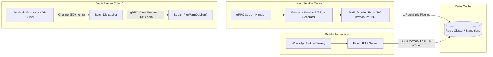

# Keceku Suplesi Engine (Monorepo Piloting)

Implementasi performa tinggi untuk subsistem **Pre-Warming Data Debitur** ke **Redis Cluster** menggunakan **gRPC Client Streaming** dan **Redis Pipeline** sebelum WhatsApp Blast diluncurkan pada aplikasi Keceku (Suplesi Otomatis Kupedes BRI).

Struktur repositori ini mengadopsi standar arsitektur monorepo Go Clean Architecture yang konsisten dengan [website-toko-sayur/user-service](https://github.com/website-toko-sayur/user-service), mencakup **Server (gRPC + Redis)** dan **Batch Feeder (Client Streaming)** dalam satu monorepo piloting.

---

## 🏗️ Struktur Folder (Monorepo Clean Architecture)

```
.
├── cmd/                                  # Cobra CLI Commands & Entrypoints
│   ├── root.go                           # Root command & inisialisasi Viper .env
│   ├── start.go                          # Command start server (alias: server)
│   ├── feeder.go                         # Command client streaming batch feeder
│   └── pilot.go                          # Command automated integrated pilot test
├── config/                               # Konfigurasi aplikasi
│   ├── config.go                         # Viper config loader (App, Redis, Feeder)
│   ├── fiber.go                          # Inisialisasi Fiber v3 & Error Handler
│   ├── redis.go                          # Universal Redis client (Standalone/Cluster)
│   └── zerolog.go                        # Zerolog logger dengan format konsol dev & JSON prod
├── gen/                                  # Generated Protobuf Go code
│   └── loan/v1/
│       ├── loan_prewarm.pb.go
│       └── loan_prewarm_grpc.pb.go
├── internal/
│   ├── adapter/                          # Adapter Layer
│   │   ├── handler/
│   │   │   ├── grpc/                     # gRPC Handler
│   │   │   │   └── prewarm_grpc_handler.go  # StreamPreWarmDebitur Handler
│   │   │   ├── http/                     # Fiber HTTP Handlers
│   │   │   │   ├── health_check_handler.go  # /health & /api/check
│   │   │   │   └── offer_handler.go         # /s/:token (Simulasi klik WA debitur)
│   │   │   └── response/
│   │   │       └── default_response.go   # Standard JSON response format
│   │   └── repository/
│   │       └── prewarm_redis_repository.go  # Redis Pipeline batching & cache lookup
│   ├── app/                              # App Lifecycle & Dependency Injection
│   │   ├── app.go                        # Server lifecycle & graceful shutdown
│   │   └── feeder_app.go                 # Feeder client runner & profiling stats
│   └── core/                             # Core Domain Layer
│       ├── domain/
│       │   ├── entity/                   # Domain Entities
│       │   │   └── debitur_entity.go     # Debitur & Suplesi Offer Entity
│       │   └── model/                    # Domain Models & DTO
│       │       └── prewarm_model.go      # Feeder job config & health model
│       └── service/                      # Business Logic Layer
│           ├── feeder_service.go         # Streaming generator & dispatcher
│           └── prewarm_service.go        # Chunk processing, token gen, & Redis batching
├── proto/                                # Protocol Buffer Definitions
│   └── keceku/loan/v1/
│       └── loan_prewarm.proto            # Definisi kontrak gRPC Client Streaming
├── utils/                                # Helpers & Utilities
│   ├── constant.go                       # Redis key prefixes & default TTL
│   └── token.go                          # Cryptographically secure URL token generator
├── .env.example                          # Contoh variabel environment
├── go.mod
├── Makefile                              # Otomasi build, proto, server, feeder, dan pilot
└── main.go                               # Main entry point (cmd.Execute())
```

---

## ⚡ Arsitektur Solusi & Keunggulan



1. **Memory Footprint Tetap Konstan (~20 MB):** Menggunakan *channel streaming* dan *batch cursor* per 500 baris, bukan memuat 100.000 debitur sekaligus ke RAM.
2. **Network Round-Trip Minimal:** Mengalirkan 100.000 data hanya dalam 200 pesan chunk di 1 koneksi stream HTTP/2 tunggal, dan dieksekusi ke Redis menggunakan **Redis Pipelining**.
3. **Mendukung Redis Cluster Otomatis:** Menggunakan `redis.UniversalClient` yang menangani sharding cross-slot secara transparan tanpa galat `CROSSSLOT`.

---

## 🚀 Panduan Menjalankan

### 1. Prasyarat
- Go 1.26+
- Docker & Redis (atau Redis lokal di port `6380` dengan password `password`)

### 2. Konfigurasi Lingkungan
Salin berkas `.env.example` menjadi `.env`:
```bash
cp .env.example .env
```

### 3. Kompilasi Protobuf (Opsional jika mengedit `.proto`)
```bash
make proto
```

### 4. Menjalankan Server (gRPC + HTTP)
```bash
# Menggunakan Makefile
make start

# Atau langsung dengan go run
go run main.go start
```
Server akan menyalakan:
- **gRPC Server:** `:50051`
- **HTTP Server:** `:8090`

### 5. Menjalankan Batch Feeder (Client Streaming)
Buka terminal terpisah lalu jalankan:
```bash
# Streaming 100.000 debitur (default chunk: 500)
go run main.go feeder --count=100000 --chunk-size=500
```

### 6. Mode Simulasi Piloting Otomatis (All-in-One)
Untuk menguji seluruh alur piloting (Server menyala, mengalirkan 100.000 debitur, memvalidasi Redis cache, menguji latensi URL pendek `< 5ms`, lalu selesai):
```bash
make pilot
# Atau: go run main.go pilot --count=100000
```

---

## 🔍 Endpoint Verifikasi

| Method | Endpoint | Deskripsi |
| :--- | :--- | :--- |
| `GET` | `/health` atau `/api/check` | Health check engine dan koneksi Redis |
| `GET` | `/s/:token` | Simulasi debitur membuka URL unik penawaran suplesi dari WhatsApp |
| `GET` | `/api/v1/stats` | Informasi jumlah total token suplesi tersimpan di Redis |

---

## 🧪 Pengujian Unit & Benchmark
```bash
# Menjalankan unit tests
go test -v ./...

# Menjalankan benchmark throughput pemrosesan chunk
go test -bench=. -benchmem ./internal/core/service/...
```
