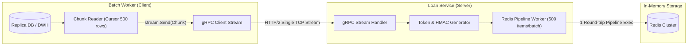

# Implementation Plan: gRPC Client Streaming untuk Pre-Warming 100.000 Debitur ke Redis

Dokumen ini menjelaskan rancangan arsitektur dan teknis mendalam khusus untuk subsistem **Pre-Warming Data Debitur** menggunakan **gRPC Client Streaming** dan **Redis Pipeline** sebelum WhatsApp Blast diluncurkan pada aplikasi Keceku (Suplesi Otomatis Kupedes BRI).

---

## Goal Description
Sebelum 100.000 pesan WhatsApp dikirimkan ke debitur, sistem harus memvalidasi data debitur dari Data Lake/Replika Database dan menyimpannya ke dalam **Redis Cluster**. 

Jika proses ini menggunakan REST API atau gRPC Unary konvensional:
1. Mengirim 100.000 data dalam 1 payload JSON/Unary raksasa akan memicu *heap memory spike* puluhan Megabyte dan rawan *Out of Memory* (OOM) atau *timeout*.
2. Mengirim 100.000 request individual satu per satu (100.000 kali round-trip HTTP) memakan waktu puluhan menit akibat *network overhead*.

**Solusi:** Menggunakan **gRPC Client Streaming** yang dipadukan dengan **Redis Pipelining**. *Batch Worker* membuka 1 koneksi stream dan mengalirkan data dalam bentuk *chunk* (misal: 500 debitur per pesan stream). Di sisi server, *Loan Service* menerima stream dan memasukkannya ke Redis secara atomik dan paralel per *batch*.

---

## User Review Required

> [!IMPORTANT]
> **Format Penyimpanan di Redis (Hash vs JSON String):**
> * Opsi A: `Redis String (JSON Raw)` -> `SET keceku:token:{token} "{...}" EX 172800`. Sangat cepat ditulis dan dibaca, hemat alokasi objek Golang.
> * Opsi B: `Redis Hash` -> `HSET keceku:token:{token} nama "..." baki_debet "..."`. Lebih fleksibel jika ingin mengambil sebagian field, tapi sedikit lebih lambat saat serialisasi massal.
> * **Rekomendasi Plan:** Menggunakan **Redis String (Protobuf/JSON bytes terkompresi)** untuk throughput pembacaan tertinggi saat 15.000 debitur klik serentak.

> [!WARNING]
> **Penggunaan Redis Cluster Hash Tag `{...}`:**
> Jika Redis menggunakan arsitektur **Redis Cluster (Sharded)**, batch pipeline antarkey berbeda bisa gagal dengan galat `CROSSSLOT Keys in request don't hash to the same slot`. Oleh karena itu, *pipelining* di server Go harus menggunakan client Redis Cluster yang mendukung *pipelining cross-slot otomatis* (seperti `go-redis/v9` dengan cluster pipeline).

---

## Open Questions

> [!NOTE]
> 1. **Masa Berlaku Penawaran (TTL Token):** Berapa lama token suplesi di Redis harus bertahan sebelum kedaluwarsa? (Default rancangan: **48 Jam**).
> 2. **Fallback Database:** Jika ada debitur yang klik link setelah 48 jam (data di Redis sudah *expired*), apakah sistem langsung menolak dengan pesan *"Penawaran Kedaluwarsa"* atau melakukan *lazy load* query lambat ke database arsip?

---

## Proposed Changes



---

### Component 1: Definisi Kontrak Protobuf (`loan_prewarm.proto`)

Spesifikasi kontrak data untuk streaming batch debitur:

#### [NEW] `proto/keceku/loan/v1/loan_prewarm.proto`
```protobuf
syntax = "proto3";

package keceku.loan.v1;
option go_package = "github.com/bri/keceku/gen/loan/v1;loanv1";

service LoanPreWarmService {
  // Client Streaming RPC: Client mengalirkan berkas debitur, Server mengembalikan ringkasan
  rpc StreamPreWarmDebitur (stream PreWarmDebiturChunk) returns (PreWarmSummaryResponse);
}

message DebiturCandidate {
  string nik                   = 1;
  string nama                  = 2;
  string nomor_rekening        = 3;
  string nomor_telepon         = 4; // Nomor tujuan WhatsApp
  string unit_kerja_id         = 5;
  int64  existing_baki_debet   = 6; // Sisa pinjaman saat ini
  int64  original_plafond      = 7; // Plafond awal Kupedes
  int64  max_suplesi_amount    = 8; // Selisih yang ditawarkan
  repeated int32 allowed_tenors = 9; // Tenor yang diizinkan (misal: 12, 24, 36)
}

message PreWarmDebiturChunk {
  string batch_id              = 1;
  repeated DebiturCandidate data = 2; // Tiap chunk berisi 500 debitur
}

message PreWarmSummaryResponse {
  string batch_id              = 1;
  int64  total_received        = 2;
  int64  total_cached          = 3;
  int64  total_failed          = 4;
  int64  duration_ms           = 5;
  repeated string failed_niks  = 6; // Daftar NIK yang gagal diproses jika ada
}
```

---

### Component 2: Sisi Server - gRPC Stream Handler & Redis Pipelining

Server menerima aliran *chunk*, membuat token akses unik (misal URL-safe token), dan mengeksekusinya ke Redis menggunakan **Pipelining** agar tidak terjadi *network round-trip* per debitur.

#### [NEW] `internal/service/prewarm_server.go`
```go
package service

import (
	"context"
	"crypto/rand"
	"encoding/hex"
	"encoding/json"
	"fmt"
	"io"
	"time"

	loanv1 "github.com/bri/keceku/gen/loan/v1"
	"github.com/redis/go-redis/v9"
	"google.golang.org/grpc/codes"
	"google.golang.org/grpc/status"
)

type PreWarmServer struct {
	loanv1.UnimplementedLoanPreWarmServiceServer
	redisClient *redis.ClusterClient
	ttl         time.Duration
}

func NewPreWarmServer(rdb *redis.ClusterClient, ttl time.Duration) *PreWarmServer {
	return &PreWarmServer{
		redisClient: rdb,
		ttl:         ttl,
	}
}

// StreamPreWarmDebitur mengimplementasikan gRPC Client Streaming
func (s *PreWarmServer) StreamPreWarmDebitur(stream loanv1.LoanPreWarmService_StreamPreWarmDebiturServer) error {
	ctx := stream.Context()
	startTime := time.Now()

	var totalReceived, totalCached, totalFailed int64
	var failedNIKs []string
	var activeBatchID string

	for {
		// 1. Cek Context Cancellation (Graceful Shutdown / Timeout)
		if err := ctx.Err(); err != nil {
			return status.Errorf(codes.Canceled, "client membatalkan stream: %v", err)
		}

		// 2. Menerima chunk dari client
		chunk, err := stream.Recv()
		if err == io.EOF {
			// Selesai membaca stream dari client, kirim balik ringkasan
			return stream.SendAndClose(&loanv1.PreWarmSummaryResponse{
				BatchId:       activeBatchID,
				TotalReceived: totalReceived,
				TotalCached:   totalCached,
				TotalFailed:   totalFailed,
				DurationMs:    time.Since(startTime).Milliseconds(),
				FailedNiks:    failedNIKs,
			})
		}
		if err != nil {
			return status.Errorf(codes.Internal, "gagal menerima chunk: %v", err)
		}

		activeBatchID = chunk.GetBatchId()
		debiturs := chunk.GetData()
		totalReceived += int64(len(debiturs))

		// 3. Gunakan Redis Pipeline untuk mengeksekusi chunk (misal 500 item) dalam 1 round-trip
		pipe := s.redisClient.Pipeline()

		for _, d := range debiturs {
			token, err := generateSecureToken()
			if err != nil {
				totalFailed++
				failedNIKs = append(failedNIKs, d.GetNik())
				continue
			}

			payloadBytes, _ := json.Marshal(d)

			// Simpan token -> data debitur
			keyToken := fmt.Sprintf("keceku:token:%s", token)
			pipe.Set(ctx, keyToken, payloadBytes, s.ttl)

			// Simpan NIK -> token (agar mudah dilacak oleh Mantri / Campaign)
			keyNIK := fmt.Sprintf("keceku:nik:%s", d.GetNik())
			pipe.Set(ctx, keyNIK, token, s.ttl)
		}

		// 4. Eksekusi batch pipeline ke Redis
		_, err = pipe.Exec(ctx)
		if err != nil {
			totalFailed += int64(len(debiturs))
			for _, d := range debiturs {
				failedNIKs = append(failedNIKs, d.GetNik())
			}
		} else {
			totalCached += int64(len(debiturs))
		}
	}
}

func generateSecureToken() (string, error) {
	bytes := make([]byte, 16)
	if _, err := rand.Read(bytes); err != nil {
		return "", err
	}
	return hex.EncodeToString(bytes), nil
}
```

---

### Component 3: Sisi Client - Batch Worker Streaming Dispatcher

Worker mengekstrak data dari database dengan kursor/paging untuk menjaga memori client tetap konstan (~20 MB), lalu mengalirkannya ke stream gRPC.

#### [NEW] `internal/batch/worker_client.go`
```go
package batch

import (
	"context"
	"log"
	"time"

	loanv1 "github.com/bri/keceku/gen/loan/v1"
	"google.golang.org/grpc"
)

const ChunkSize = 500 // 500 debitur per gRPC message

type BatchDispatcher struct {
	client loanv1.LoanPreWarmServiceClient
}

func NewBatchDispatcher(conn *grpc.ClientConn) *BatchDispatcher {
	return &BatchDispatcher{
		client: loanv1.NewLoanPreWarmServiceClient(conn),
	}
}

func (b *BatchDispatcher) RunPreWarmCampaign(ctx context.Context, batchID string, dataSource <-chan *loanv1.DebiturCandidate) (*loanv1.PreWarmSummaryResponse, error) {
	// 1. Buka Client Stream ke Loan Service
	stream, err := b.client.StreamPreWarmDebitur(ctx)
	if err != nil {
		return nil, err
	}

	currentChunk := make([]*loanv1.DebiturCandidate, 0, ChunkSize)
	chunkIndex := 0

	// 2. Baca channel data (stream dari database)
	for debitur := range dataSource {
		currentChunk = append(currentChunk, debitur)

		// Jika sudah mencapai 500 record, kirim sebagai 1 pesan chunk
		if len(currentChunk) >= ChunkSize {
			chunkIndex++
			err := stream.Send(&loanv1.PreWarmDebiturChunk{
				BatchId: batchID,
				Data:    currentChunk,
			})
			if err != nil {
				return nil, err
			}
			log.Printf("[Batch %s] Chunk %d terkirim (500 debitur)", batchID, chunkIndex)
			currentChunk = make([]*loanv1.DebiturCandidate, 0, ChunkSize)
		}
	}

	// 3. Kirim sisa data terakhir jika ada
	if len(currentChunk) > 0 {
		err := stream.Send(&loanv1.PreWarmDebiturChunk{
			BatchId: batchID,
			Data:    currentChunk,
		})
		if err != nil {
			return nil, err
		}
	}

	// 4. Tutup stream dan terima summary response
	summary, err := stream.CloseAndRecv()
	if err != nil {
		return nil, err
	}

	return summary, nil
}
```

---

## 4. Desain Skema & Estimasi Beban Memori Redis

### Struktur Key & Value di Redis:
| Key Format | Tipe | Contoh Value | TTL | Ukuran Rata-rata |
| :--- | :--- | :--- | :--- | :--- |
| `keceku:token:{token}` | String (JSON) | `{"nik":"3201...","nama":"Budi","max_suplesi":25000000,...}` | 48 Jam | $\approx 350 \text{ bytes}$ |
| `keceku:nik:{nik}` | String | `a4f3b610d9e...` (Token) | 48 Jam | $\approx 64 \text{ bytes}$ |

### Kalkulasi Kapasitas Memori (100.000 Debitur):
* Data Token: $100.000 \times 350 \text{ bytes} \approx 35 \text{ MB}$
* Index NIK: $100.000 \times 64 \text{ bytes} \approx 6.4 \text{ MB}$
* Metadata Overhead Redis: $\approx 15 \text{ MB}$
* **Total Kebutuhan Memori:** $\approx \mathbf{56.4 \text{ MB}}$

> [!TIP]
> Kapasitas 56.4 MB ini sangat kecil dan aman bahkan untuk cluster Redis dengan spesifikasi paling minimal sekalipun.

---

## Verification Plan

### Automated Tests
1. **Benchmark Test Throughput Stream:**
   * Menjalankan unit test dengan mock stream untuk mengukur durasi pemrosesan 100.000 records ke Redis lokal/container.
   ```bash
   go test -bench=BenchmarkStreamPreWarm -benchmem ./internal/service/...
   ```
   * *Target:* 100.000 records selesai di-cache dalam waktu $< 15 \text{ detik}$.
2. **Error Handling & Disconnect Test:**
   * Memutus stream di tengah jalan (misal pada chunk ke-50) untuk memvalidasi bahwa context cancellation dan cleanup transaksi Redis berjalan dengan benar.

### Manual Verification
1. Jalankan script dummy feeder dengan 100.000 debitur sintetis.
2. Cek jumlah key yang berhasil disimpan di Redis:
   ```bash
   redis-cli -c -p 6379 DBSIZE
   ```
3. Uji simulasi debitur membuka URL pendek menggunakan token dari Redis:
   ```bash
   curl -X GET "http://localhost:8080/s/a4f3b610d9e..."
   ```
   *Pastikan response payload penawaran suplesi kembali dengan latensi $< 5 \text{ ms}$.*
